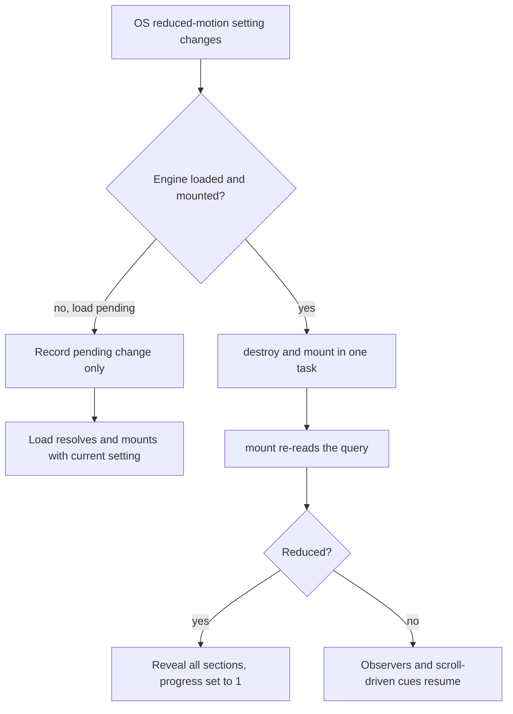

# Website Motion and Interaction Fixes - Plan

---

## Goal Capsule

- **Objective:** Visitors to the public CLIF Foundation site get immediate, consistent feedback on every link, button, chip, menu and form, with no sticky hover after taps, no layout jumps on state changes, and motion that respects their reduced-motion setting even when they change it mid-visit.
- **Means:** Move remaining inline and JS-driven interaction states onto the existing CSS class system with one shared motion vocabulary (KTD1, KTD2), plus targeted fixes in the scroll engine (KTD5, KTD6).
- **Authority:** Product Contract requirements win on behavior. KTDs win on mechanism. Units override neither.
- **Stop conditions:** Stop and report if a change would touch `src/app/portal/**` or `src/components/portal/**`, if the no-JavaScript menu fallback stops showing the links, or if any existing e2e test regresses for a reason the plan does not explain.
- **Execution profile:** One branch, `feat/website-edits`, pushed to draft PR #28. No merge or deploy without the owner's explicit "ship it".
- **Finishes and ships:** The implementing agent commits and pushes to PR #28. The owner (J.C.) approves merge.

---

## Product Contract

### Summary

Apply the verified website findings from the October 18 six-agent motion audit. Gate every hover to fine pointers, give the phone menu a short entrance, bring the copy-email button and filter chips onto the button system, give the inquiry form clear status feedback, remove idle per-frame work from the scroll engine, make reduced motion respond live, and add numeric and text-wrapping polish.

### Problem Frame

The home page motion was reworked earlier the same day and passed two audits. A wider audit of the whole public site found the remaining gaps sit outside the home page and in shared pieces. Header links and several controls keep a hover colour after a tap on phones. The phone menu appears with no transition. The copy button and filter chips are inline-styled, so they cannot have hover or press states, and the copy label swap jumps the button width. The inquiry form gives no sign that it is opening a mail app. The scroll engine runs an animation-frame loop every frame even when nothing needs it. Reduced motion is read once at load.

### Requirements

**Interaction states**
- R1. Hover styles apply only on devices whose primary pointer can hover finely, and never stick after a tap.
- R2. Publication rows and inline text links share the row-link and prose-link hover treatment used on the home page, driven by CSS rather than React state.
- R3. The copy-email button and filter chips have the same hover, press and colour-transition behaviour as other buttons, and a pressed chip keeps its pressed fill while hovered.
- R4. The copy-email button keeps a stable width when its label changes, announces the change once to screen readers, and does not claim success when the copy failed.

**Menu and forms**
- R5. Opening the phone menu fades and settles it in. Closing is instant. Visitors without JavaScript still see the links.
- R6. Submitting the inquiry form shows a status line telling the visitor their email app should open, with a fallback address, and errors fade in rather than popping. The submit button keeps its width and cannot open two drafts from a double click.

**Engine and accessibility**
- R7. The scroll engine does no per-frame work when nothing on the page needs it.
- R8. Turning reduced motion on or off in the operating system takes effect without a reload.
- R9. Under reduced motion, press feedback does not scale elements.

**Polish**
- R10. Years, hour ticks and data-panel values use tabular figures. Body paragraphs avoid single-word last lines.

### Key Decisions

- **Restrained motion only.** No route transitions, theme-switch animation, data-table or filter-result animation, focus-ring animation, or animation of the Givebutter widget. Governs R5, R6. (session-settled: user-approved — chosen over adding entrance or route animations: a credible, calm, scientific audience, and the audits flagged extra motion as AI-generated)
- **Hover only on fine pointers.** Governs R1, R2, R3. (session-settled: user-approved — chosen over ungated hover: hover sticks after taps on touch screens)

### Scope Boundaries

- Public site only. Portal files are owned by another session and are excluded, including the portal hover rules in `src/app/globals.css` (`.cl-formButtonPrimary`, `.portal-job-row`, the file-selector button).
- `src/app/globals.css` is shared with the portal. Changes there must be scoped to public classes, and the portal session is told before push.

### Deferred to Follow-Up Work

- The fixed `id="inquiry-message"` in `src/components/support/InquiryForm.tsx` should become per-instance because Next keeps hidden pages mounted. Noted, not in scope.
- Capture the `data-open` plus `@starting-style` menu pattern in `docs/solutions/`.

---

## Planning Contract

### Key Technical Decisions

- KTD1. **One motion vocabulary at `:root`.** Add `--ease-out: cubic-bezier(0.23, 1, 0.32, 1)` and `--duration-hover: 160ms` beside `--ease-standard` and `--duration-fast` in `src/styles/spacing.css`. Move `--sc-ease-out: var(--ease-out)` and `--sc-d-hover: var(--duration-hover)` out of the `.sc-home` block in `src/styles/scrollcraft-devices.css` into a `:root` rule, so they resolve on every public page. `--sc-d-state` and `--sc-d-reveal` stay as literal values in `.sc-home`. This also fixes `.sc-row-link` outside `.sc-home`, where its tokens are currently undefined and its transition silently drops. (session-settled: user-approved — chosen over per-component hand-typed curves: one curve keeps motion cohesive)
- KTD2. **Classes, not inline styles, for interactive controls.** `FilterChip` and `CopyEmailButton` render class names styled in `src/app/globals.css` next to the `.btn` rules, so `:hover`, `:active` and `[aria-pressed]` can apply. Hover rules sit inside the existing `@media (hover: hover) and (pointer: fine)` block. Chip hover is written as `:hover:not([aria-pressed="true"])`.
- KTD3. **Menu entry via `@starting-style` on the open rule only.** The panel starts at opacity 0 and `translateY(-4px)` and settles to opacity 1 and no transform over 180ms with `--ease-out`. The transition and starting style live on `.site-menu-panel[data-open="true"]` inside the existing max-width 999px media query. The closed rule carries no opacity and no transition, so close is instant and the noscript rule (which forces `display: grid` with `data-open="false"`) never inherits a hidden starting state. (session-settled: user-approved — chosen over a grid-template-rows height animation: compositor-only properties and a simpler rule)
- KTD4. **Copy label crossfade by grid stacking.** All three labels (copy, copied, failed) occupy the same grid cell, so the button width is the widest label at any font size or zoom. Visual labels are `aria-hidden` and the button carries a constant accessible name ("Copy email address"). One visually hidden `role="status"` region, a sibling outside the button, announces "Email address copied" or the failure text. The reset timer is held in a ref and cleared on each click and on unmount.
- KTD5. **Engine work only when needed.** Run the animation-frame `tick` loop only while a clip playhead is in view and still needs per-frame updates, stop it after a tick with no work, and pause it while the tab is hidden. Cache the document scroll height in `layout()` (which already runs on resize and font load) instead of reading it in every `read()`, because `maxY` still feeds the pinned-clip mapping for video acts.
- KTD6. **Live reduced motion by remounting.** The engine re-reads the reduced-motion query at the start of each `mount()` and updates the exposed `ScrollCraft.reduce`. `ScrollCraftMount` listens for query changes inside its existing effect and performs destroy and mount in the same task, guarded against a pending engine load. A reload was rejected because it loses scroll position and form state.
- KTD7. **ICU time cursor via transform.** The cursor's container gets `container-type: inline-size`, and the cursor moves with `transform: translateX(...)` computed from `cqw` and the 236px label offset, with a `left: 236px` base for browsers without container units.

### High-Level Technical Design

Reduced-motion remount, the one multi-step lifecycle in this plan:

### Assumptions

- Owner rule: no semicolons in site copy, including the new status text.
- An iPad with a trackpad reports a coarse primary pointer and gets no hover. Accepted.
- The `base.css` reduced-motion rule already shortens transitions to 0.01ms, so new transitions need no separate reduced-motion rule except the `:active` transforms (R9).

### Sources

- Audit findings and verification from this session's six audits and three planning research passes.
- Prior menu history: commits f9d92fb, 54dc03e, 1569062 (`data-open`, Activity cleanup, focus on widening).
- Prior motion passes: commits f196c76, 085835b (`.btn` classes, hover media block, `--sc-p` write guard).

---

## Implementation Units

### U1. Root motion tokens and reduced-motion press

- **Goal:** One set of motion tokens available everywhere, and no scale on press under reduced motion.
- **Requirements:** R9, KTD1
- **Dependencies:** none
- **Files:** `src/styles/spacing.css`, `src/styles/scrollcraft-devices.css`, `src/styles/base.css`, `src/app/globals.css`, `scripts/checks/`, `tests/e2e/motion-ux.test.mjs`
- **Approach:**
  1. Add the root tokens in `spacing.css`.
  2. Move the `--sc-ease-out` and `--sc-d-hover` aliases to `:root` per KTD1.
  3. Replace the hand-typed curve in the `.btn` transition with the token.
  4. In the `base.css` reduced-motion block, set `transform: none !important` for the `:active` states of `.btn` and `.sc-program-card`, matching that block's existing `!important` convention so it beats the later-loaded rules.
  5. Commit the session's axe, site, review and reduced-motion check scripts under `scripts/checks/` so the Verification Contract gates can be run from the repo.
- **Test scenarios:**
  - With reduced motion emulated, pressing a `.btn` leaves its computed transform as `none`.
- **Verification:** Lint passes. The new e2e scenario passes. The check scripts run from `scripts/checks/`.

### U2. Hover gating, row links and prose links

- **Goal:** Every public hover is gated, and rows and inline links use shared CSS classes.
- **Requirements:** R1, R2, KTD2
- **Dependencies:** U1
- **Files:** `src/styles/base.css`, `src/app/globals.css`, `src/styles/scrollcraft-devices.css`, `src/components/data/PublicationRow.tsx`, `src/app/mission/page.tsx`, `src/app/our-work/page.tsx`, `src/components/home/IcuStayFigure.tsx`, `tests/e2e/motion-ux.test.mjs`
- **Approach:**
  1. Wrap `a:hover` in `base.css` and the public hover rules in `globals.css` (`.site-nav-link`, `.site-nav-cta`, `.clif-theme-btn`, `.site-menu-theme`, `.site-menu-btn`, `.linkish`) and `.sc-folio__item:hover` in the fine-pointer media query. Leave portal and Clerk rules untouched.
  2. `PublicationRow` drops its hover state and inline colour and decoration, and uses `.sc-row-link` and `.sc-row-link__t`, keeping its 44px minimum height.
  3. Add a `.prose-link` class beside `.sc-colophon a` and apply it to the four inline-styled links.
- **Patterns to follow:** `.sc-row-link` rules in `scrollcraft-devices.css`, the `.btn` hover block at the end of `globals.css`.
- **Test scenarios:**
  - On `/research`, a `.sc-row-link__t` element resolves a non-empty transition duration (token defined outside `.sc-home`).
  - Every stylesheet rule whose selector contains `:hover` on a public page is nested inside a media rule matching `(hover: hover)`, excluding portal-only selectors.
  - On `/research` at desktop, hovering a publication row turns its title the link colour.
  - The 44px tap-target test for `/research` still passes.
- **Verification:** The stylesheet scan finds zero ungated public hover rules.

### U3. Phone menu entrance

- **Goal:** The phone menu fades in on open and closes instantly, with the no-JS fallback intact.
- **Requirements:** R5, KTD3
- **Dependencies:** U1
- **Files:** `src/app/globals.css`, `tests/e2e/motion-ux.test.mjs`
- **Approach:** Add the 180ms opacity and transform transition per KTD3, `transition-behavior: allow-discrete` for display, and the `@starting-style` block to the open rule only. No change to `SiteHeader.tsx` behaviour.
- **Test scenarios:**
  - At 390px, clicking Menu sets `data-open="true"` and the panel reaches opacity 1 within 300ms.
  - Pressing Escape after opening closes the panel immediately (display none on the next frame).
  - With JavaScript disabled at 390px, the panel links are visible at full opacity.
  - Opening, navigating via a panel link, then going Back shows the menu closed with no entry replay.
  - Widening past 1000px with the menu open keeps focus on a visible element.
- **Verification:** The existing site checks for no-JS nav, Back and widening still pass.

### U4. Filter chips and copy-email button on the button system

- **Goal:** Chips and the copy button get hover, press and stable width.
- **Requirements:** R3, R4, KTD2, KTD4
- **Dependencies:** U1
- **Files:** `src/components/core/FilterChip.tsx`, `src/components/support/CopyEmailButton.tsx`, `src/app/globals.css`, `tests/e2e/motion-ux.test.mjs`
- **Approach:**
  1. Move chip and copy-button styling to classes. The pressed chip style keys off `aria-pressed`.
  2. Copy button stacks all three labels in one grid cell and crossfades over 120ms with the ease-out token, per KTD4.
  3. The timer is held in a ref, cleared on click and unmount.
  4. A failed clipboard write shows the failure label "Copy failed, select the address instead" (no semicolons) instead of "Copied".
  5. Add the new chip and copy-button `:active` selectors to the `base.css` reduced-motion override from U1.
- **Test scenarios:**
  - On `/support`, the copy button width is identical before clicking, after a successful copy, and after a failed copy.
  - The copy button's accessible name is unchanged before and after clicking.
  - Clicking twice within the reset window leaves the label in the copied state for a full window after the second click.
  - With the clipboard API unavailable, the button does not show "Copied".
  - The live region text changes exactly once per click.
  - On `/research`, a pressed chip keeps its pressed background while hovered.
  - Toggling a chip updates `aria-pressed`.
- **Verification:** New scenarios pass. Axe reports no new violations on `/support` and `/research`.

### U5. Inquiry form feedback

- **Goal:** Visitors see that their mail app should open, with a fallback, and errors fade in.
- **Requirements:** R6
- **Dependencies:** U1
- **Files:** `src/components/support/InquiryForm.tsx`, `src/app/globals.css`, `tests/e2e/motion-ux.test.mjs`
- **Approach:**
  1. Add a status state set just before the mail redirect, not cleared by the existing `finally`, and cleared on the next edit or submit.
  2. Status and error are mutually exclusive.
  3. The submit button reserves the width of its widest label and stays disabled (`aria-disabled`) from submit until the next field edit.
  4. The error paragraph gets a class with a 160ms fade-in using `@starting-style`.
  5. Status copy names the fallback address and contains no semicolons.
  6. The status line sits directly under the submit button.
- **Test scenarios:**
  - Submitting a valid form shows the status line in a `role="status"` region.
  - Editing a field after submit clears the status line.
  - An invalid submission shows the error and no status line.
  - Double-clicking submit navigates to the mail link once.
  - A second click after the redirect, with no edit in between, does not navigate again.
  - The submit button width is identical before and after submitting.
- **Verification:** New scenarios pass. Copy check finds no semicolons on `/support`.

### U6. Scroll engine idle work and ICU cursor

- **Goal:** No per-frame engine work when nothing needs it, and the ICU cursor moves without layout.
- **Requirements:** R7, KTD5, KTD7
- **Dependencies:** none
- **Files:** `public/scrollcraft/scrollcraft.js`, `src/styles/scrollcraft-devices.css`, `src/components/home/IcuStayFigure.tsx`, `tests/e2e/motion-ux.test.mjs`
- **Approach:**
  1. Gate the tick loop on the presence of playheads and on page visibility, and start it when a clip registers.
  2. Cache the scroll height in `layout()` and use the cached value in `read()`.
  3. Give the ICU cursor container `container-type: inline-size` and move the cursor by transform with a `left` base.
- **Test scenarios:**
  - On the home page with no scrolling for one second, the engine schedules no animation frames.
  - Scrolling still updates `--sc-p` on the federation act.
  - The ICU cursor sits at the 0h column when the figure first enters and at the 72h column at the end of its sweep, at 1440px and inside the scroller at 390px.
- **Verification:** Existing home e2e tests (folio, federation, lattice text) and the reduced-motion check still pass.

### U7. Live reduced motion

- **Goal:** Changing the OS reduced-motion setting takes effect without reload.
- **Requirements:** R8, KTD6
- **Dependencies:** U6
- **Files:** `public/scrollcraft/scrollcraft.js`, `src/components/home/ScrollCraftMount.tsx`, `tests/e2e/motion-ux.test.mjs`
- **Approach:**
  1. `mount()` re-reads the query and updates the exposed flag.
  2. `ScrollCraftMount` adds a change listener in its effect, remounts in one task, and ignores changes while the engine is still loading (the load then mounts with the current value).
  3. The listener is removed in the effect cleanup, so a hidden page does not react.
- **Test scenarios:**
  - Load the home page with full motion, switch emulated reduced motion on, and the federation act's `--sc-p` becomes 1 and all reveal sections become visible without reload.
  - Switch back to full motion and scroll, and cues respond to scroll again.
  - Switching during the first second after load produces exactly one mounted engine.
- **Verification:** New scenarios pass. The reduced-motion check reports zero faint in-view text.

### U8. Numeric and text-wrapping polish

- **Goal:** Tabular figures for numbers and better paragraph wrapping.
- **Requirements:** R10
- **Dependencies:** none
- **Files:** `src/app/globals.css`, `src/components/home/IcuStayFigure.tsx`, `src/components/data/PublicationRow.tsx`, `src/components/home/HomeScroll.tsx`, `src/components/data/DataPanel.tsx`, `src/components/data/KeyValueList.tsx`
- **Approach:** Apply `font-variant-numeric: tabular-nums` to the hour ticks, year spans, data panels and key-value lists, and `text-wrap: pretty` to body paragraphs through a shared rule rather than more inline styles.
- **Test expectation:** none -- typographic styling with no behavioural change, covered by visual screenshots.
- **Verification:** Screenshots of `/`, `/research` and `/support` at 1440px and 390px show no layout regressions.

---

## Verification Contract

| Gate | Command or check | Applies to |
|---|---|---|
| Lint and types | `npm run lint`, `npx tsc --noEmit -p .` | all units |
| Unit tests | `npm run test:unit` | regression |
| End-to-end | `npm run test:e2e` with `E2E_PORT` set to a free port in 43160-43199 (the existing `tests/e2e/*.test.mjs` suite plus `tests/e2e/motion-ux.test.mjs`) | U1-U7 |
| Accessibility | `scripts/checks/` axe script across 6 pages at 1280 and 390, light and dark | U2-U5 |
| Site checks | `scripts/checks/` site, review and reduced-motion scripts against `next start` on port 43139 | U2-U7 |

The only expected site-check failure is "F12 hosted giving link", which the owner declined. Servers run only on port 43139 and e2e ports 4316x-4319x, and are stopped by PID.

---

## Definition of Done

- All requirements R1-R10 hold, each verified by its unit's scenarios or screenshots.
- Every gate in the Verification Contract passes, apart from the declined F12 check.
- No file under `src/app/portal/**` or `src/components/portal/**` changed.
- The portal session has been told about the `globals.css` changes before push.
- No experimental or abandoned code is left in the diff.
- Changes are committed and pushed to PR #28, which stays a draft and is not merged.
