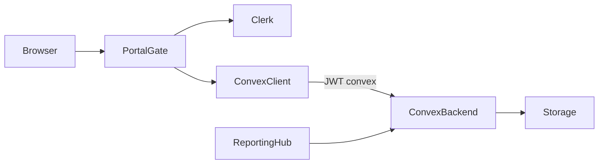

# Private board portal — hardened implementation plan

LLM-executable plan (Matt **make-plan** phases + ce-plan structure). Code for Units 1–6 already landed on branch `cursor/private-board-portal-compliance-plan-ee69`; this document is the **source of truth** for what shipped, what to harden next, and how to verify without inventing APIs.

---

## Summary

Ship a Clerk-gated **`/portal`** on Convex for CLIF Foundation board governance: documents, meetings/minutes, motions/votes, Form 990–aligned compliance, and a **Reporting pack** so directors can pull tax/policy/financial files for CPA and filing prep in one place. Public marketing pages stay usable without portal env keys.

**Current state (2026-10-17):** Core portal + reporting UI + Convex schema are implemented. Hardening phases (H1–H5) close gaps: allowlist admin UI, ZIP audit export, auth helpers (`useConvexAuth`), detail routes, e2e, deploy wiring.

---

## Problem frame

| Pain | Why it matters |
| --- | --- |
| Governance files live in email/Drive | No audit trail; hard for Form 990 / CPA requests |
| Minutes and votes informal | Illinois requires minutes; IRS expects contemporaneous records |
| Policy “yes” on Form 990 without evidence | Donors/regulators expect COI disclosures + adoption votes in minutes |
| Board members struggle to find the right PDF | Reporting must be **one click**, grouped by purpose |

---

## Requirements (traceability)

| ID | Requirement | Status |
| --- | --- | --- |
| R1 | Unauthenticated users cannot access portal data (middleware + Convex) | Shipped (harden: `useConvexAuth`) |
| R2 | Email allowlist when `boardMembers` nonempty | Backend shipped; **admin UI missing** |
| R3 | Document library with tax/policy/financial/legal/meeting categories + retention | Shipped |
| R4 | Meetings + attendance + quorum | Shipped (list UI; no `[id]` route) |
| R5 | Minutes draft → review → approved; export | Shipped (markdown; PDF optional later) |
| R6 | Motions + ballots; server tallies | Shipped |
| R7 | Written consent motions (all directors must vote yes) | Schema + tally shipped |
| R8 | Annual COI disclosure | Shipped |
| R9 | Policy registry | Shipped |
| R10 | Retention + legal hold (no auto-delete) | Fields + setHold shipped; archive guard incomplete |
| R11 | Form 990 board-review record | Shipped |
| R12 | Minutes export suitable for reporting | Partial (markdown; expand fields) |
| R13 | Portal noindex; public build without keys | Shipped |
| R14 | PRODUCT.md / README document portal | Shipped |
| R15 | **Reporting pack** — grouped downloads + manifest | Shipped |
| R16 | **ZIP/date-range audit export** for CPA | **Not shipped** |
| R17 | Portal e2e / Convex tests for T1–T6 | **Not shipped** |
| R18 | Production Convex+Clerk+Vercel deploy path | Partial (docs; no `vercel-build.sh`) |

**Actors:** A1 Director (member), A2 Secretary, A3 Chair, A4 Admin, A5 CPA (receives exports only).

**Key flows:** F1 Sign-in → Reporting pack download; F2 Upload tax PDF → appears in Reporting pack; F3 Meeting → minutes approve → export; F4 Open motion → ballot → close; F5 Annual COI; F6 Mark 990 reviewed.

---

## Scope boundaries

- Not legal/tax advice; not IRS e-file or Illinois AG filing.
- No DocuSign; no whistleblower intake form (policy text only).
- No auto document destruction.
- Deferred: email notifications, Clerk Organizations, public 990 webpage.

---

## Phase 0: Documentation discovery (Allowed APIs)

### Sources consulted (MCP + local)

| Source | Finding |
| --- | --- |
| [Convex & Clerk](https://docs.convex.dev/auth/clerk) (Tavily extract) | `auth.config.ts` with `domain: process.env.CLERK_JWT_ISSUER_DOMAIN`, `applicationID: "convex"`; set issuer on **Convex dashboard** (not only `.env`); `ConvexProviderWithClerk` + `useAuth` from `@clerk/nextjs`; prefer **`useConvexAuth()`** over Clerk `useAuth()` for “is authenticated for Convex” |
| [Clerk × Convex](https://clerk.com/docs/guides/development/integrations/databases/convex) | Activate Convex integration in Clerk Dashboard; ClerkProvider wraps Convex provider; production Frontend API URL on Convex prod deploy |
| Explore agent (repo) | Key paths listed below; gaps: allowlist UI, ZIP, e2e, `convex.json`, detail routes |
| Git `68dfcbe^` | Original portal patterns (middleware protect, document upload Effect pipeline) |
| `AGENTS.md` / Next 16 | Read `node_modules/next/dist/docs/` before middleware/proxy changes; `usePathname` needs Suspense under Cache Components |

### Allowed APIs (copy these; do not invent)

| Domain | Allowed | Copy from |
| --- | --- | --- |
| Clerk middleware | `clerkMiddleware`, `createRouteMatcher`, `auth.protect()` | `src/middleware.ts` + [Clerk middleware docs](https://clerk.com/docs/references/nextjs/clerk-middleware) |
| Clerk UI | `ClerkProvider`, `SignIn`, `UserButton`, `useAuth` | `src/components/providers/AppProviders.tsx`, `src/app/portal/sign-in/...` |
| Convex + Clerk client | `ConvexProviderWithClerk`, `ConvexReactClient`, **`useConvexAuth`**, `Authenticated` / `Unauthenticated` | [docs.convex.dev/auth/clerk](https://docs.convex.dev/auth/clerk); local `ConvexClientProvider.tsx` |
| Convex server auth | `ctx.auth.getUserIdentity()`, throw if null | `convex/lib/auth.ts` → `requireBoardIdentity` |
| Convex data | `query`/`mutation` with `args` + `returns` validators; indexed `.take(n)` | Existing `convex/*.ts` |
| File storage | `ctx.storage.generateUploadUrl()`, `getUrl()` | `convex/documents.ts` |
| Upload pipeline | `uploadDocumentProgram` Effect 4 | `src/lib/effect/upload.ts` |
| Client queries | `useQuery` / `useMutation` from `convex/react` + `api.*` | Portal components |

### Anti-patterns (do NOT)

- Use Clerk `useAuth().isSignedIn` alone to gate Convex queries (token may not be ready) — use `useConvexAuth()`.
- Unbounded `.collect()` on `ballots` / `auditEvents` / `documents`.
- Client-side vote tallies as source of truth.
- Import Node builtins in Convex without `"use node"`.
- Hard-delete documents under legal hold.
- Link `/portal` from public `SiteHeader`.
- Claim 501(c)(3) / deductibility in portal copy while determination pending.
- Set `export const dynamic` when `cacheComponents` is on (Next 16) — use Suspense instead.
- Invent ZIP APIs on Convex storage — client-side ZIP from signed URLs or Convex action with documented fetch pattern.

---

## Architecture (as shipped)

**Key files (copy targets):**

| Concern | Path |
| --- | --- |
| AuthZ | `convex/lib/auth.ts` |
| Middleware | `src/middleware.ts` |
| Providers | `src/components/providers/AppProviders.tsx`, `ConvexClientProvider.tsx` |
| Gate / shell | `src/components/portal/PortalGate.tsx`, `PortalShell.tsx` |
| Reporting | `convex/reporting.ts`, `src/components/portal/ReportingHub.tsx` |
| Schema | `convex/schema.ts` |
| Plan | `docs/plans/private-board-portal.md` |

---

## Implementation phases

### Phase A — Baseline (DONE on branch)

**What:** Restore Clerk+Convex shell; documents; meetings/minutes; motions; COI; policies; form990; compliance dashboard; Reporting pack; README/PRODUCT.

**Verify:**

- [x] `npm run build` without Clerk keys
- [x] Portal routes noindex; Suspense around `usePathname`
- [x] Convex push with `CLERK_JWT_ISSUER_DOMAIN` set on deployment
- [x] Configure message when keys missing

**Anti-pattern guard:** Do not re-delete portal to “keep site static.”

---

### Phase H1 — Auth hardening (NEXT)

**What to implement (copy from docs):**

1. In portal signed-in UI, gate Convex-dependent children with `Authenticated` / `useConvexAuth` from `convex/react` — pattern from [Convex Clerk Next.js guide step 11](https://docs.convex.dev/auth/clerk#nextjs).
2. Keep Clerk `auth.protect()` in `src/middleware.ts` for route protection.
3. Document production setup: Clerk Dashboard → Activate Convex integration → set Frontend API URL as `CLERK_JWT_ISSUER_DOMAIN` on **both** Convex dev and prod deployments ([dev/prod section](https://docs.convex.dev/auth/clerk#configuring-dev-and-prod-instances)).

**Verify:**

- [ ] After Clerk sign-in, `useConvexAuth().isAuthenticated === true` before first `useQuery`
- [ ] Misconfigured issuer → clear error path (document debugging link: Convex Debugging Authentication)

**Anti-pattern:** Nesting ConvexProvider outside ClerkProvider.

---

### Phase H2 — Allowlist admin + seed

**What:**

1. UI page `/portal/members` (admin only): form calling `api.board.upsertMember` (already in `convex/board.ts`).
2. Optional script `scripts/seed-board-members.mjs` or Convex internal mutation: seed emails from a **private** allowlist file (not public `board-members.json` — that file has no emails today). Admin pastes emails for directors.
3. Role picker: `member` | `secretary` | `chair` | `admin`.

**Verify:**

- [ ] T1: non-allowlisted user gets Convex unauthorized on `listDocuments`
- [ ] Admin can add second email; that user can sign in and load Reporting pack

**Anti-pattern:** Putting personal emails in public git JSON.

---

### Phase H3 — Reporting UX hardening (board ease)

**What:**

1. **ZIP pack (client):** On Reporting pack, “Download all as ZIP” using browser ZIP (e.g. `fflate` or `jszip`) fetching each `downloadUrl` — keep Convex as URL source (`getReportingPack`).
2. Date-range filter on reporting query for minutes + docs `createdAt`.
3. Prominent empty-state CTAs: “Upload a Form 990 draft” → `/portal/documents` with category=tax preselected (query param).
4. Optional: `?category=tax` support on Documents page.

**Verify:**

- [ ] Board member downloads ZIP with ≥1 tax + 1 policy file after upload
- [ ] Manifest JSON still works without ZIP dependency failure

**Anti-pattern:** Storing ZIP blobs in Convex as permanent duplicates of each file.

---

### Phase H4 — Governance completeness

**What:**

1. Detail routes `/portal/meetings/[id]`, `/portal/votes/[id]` (plan IA) — move detail panels from list pages.
2. Minutes version bump: when approved, next edit creates `version+1` draft (today approve locks; create-new-version mutation).
3. `archiveDocument` mutation that **fails** if `legalHold` (T6).
4. Expand `getMinutesExport` to include open/closed motion tallies + COI recusal lines (R12).
5. Consent motion: block `status=closed` as passed unless `yes === eligible` (enforce in `setMotionStatus`).

**Verify:** T2, T3, T5, T6 automated or scripted Convex tests.

**Anti-pattern:** Editing approved minutes in place.

---

### Phase H5 — Deploy, tests, ops

**What:**

1. Add `convex.json` if required by team tooling; restore Convex-aware Vercel build (`npx convex deploy --cmd 'npm run build' --cmd-url-env-var-name NEXT_PUBLIC_CONVEX_URL`) from git history when cloud keys exist — see Convex Vercel hosting docs.
2. E2E smoke (Playwright in `tests/e2e/`): `/portal` configure message without keys; with keys (env-gated) sign-in redirect.
3. Convex unit tests for tally + allowlist (if `convex-test` adopted) or Node test harness calling pure helpers in `convex/lib/quorum.ts`.
4. Ops checklist in README: Clerk Convex integration, Vercel env, first-admin claim, seed members.

**Verify:**

- [ ] Preview/prod deploy with portal env green
- [ ] Public e2e suite still passes
- [ ] Portal smoke test skipped cleanly when secrets absent

---

## Phase V — Final verification

1. Grep guards: no `useAuth` alone gating Convex data fetches in portal components; no `.collect()` without `.take` on growing tables.
2. Manual board walkthrough: F1–F6.
3. Compliance checklist vs Form 990 Part VI (COI, whistleblower, retention, 990 review) using NCNA / IRS sources in References.
4. Confirm sitemap/nav exclude portal.

---

## Test scenarios (full)

| ID | Scenario | Phase |
| --- | --- | --- |
| T1 | Non-allowlisted Clerk user → Convex error | H2 |
| T2 | Approved minutes immutable; new version for edits | H4 |
| T3 | Recusal recorded; ballot rules as designed | H4 |
| T4 | Incomplete COI → compliance dashboard incomplete | A (manual) |
| T5 | Consent incomplete → not passed when closed | H4 |
| T6 | Legal hold blocks archive | H4 |
| T7 | Reporting ZIP contains tax + policy files | H3 |
| T8 | `useConvexAuth` false until token ready; no flash of Convex errors | H1 |

---

## Key technical decisions

1. **Restore-and-extend** Convex+Clerk in this repo (not a separate app).
2. **Reporting pack is the primary board UX** for paperwork; Documents is for upload/manage.
3. **ZIP is client-assembled** from short-lived storage URLs (H3).
4. **Allowlist emails stay out of public JSON**; admin UI / private seed only.
5. **Auth readiness:** Convex docs mandate `useConvexAuth` for query gating (H1).

---

## Assumptions

- Board will use Clerk-hosted accounts (email OTP or Google) restricted by allowlist.
- Quorum default remains majority of allowlisted directors until bylaws numbers are entered in `orgSettings`.
- Production Convex project will be linked (not only anonymous local).

---

## References

- [Convex & Clerk](https://docs.convex.dev/auth/clerk)
- [Clerk integrate Convex](https://clerk.com/docs/guides/development/integrations/databases/convex)
- [NCNA good governance policies](https://www.councilofnonprofits.org/running-nonprofit/governance-leadership/good-governance-policies-nonprofits)
- [NCNA document retention](https://www.councilofnonprofits.org/running-nonprofit/governance-leadership/document-retention-policies-nonprofits)
- [IRS Form 990 instructions](https://www.irs.gov/pub/irs-pdf/i990.pdf)
- [805 ILCS 105](https://www.ilga.gov/legislation/ILCS/details?ActID=2280)
- Local: `PRODUCT.md`, `README.md`, `src/middleware.ts`, `convex/lib/auth.ts`
