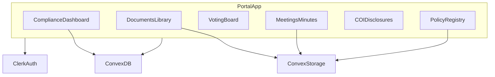

# Private board portal

## Summary

Reintroduce a Clerk-gated **`/portal`** (Clerk + Convex, recoverable from git before [`68dfcbe`](https://github.com/sajor2000/clif-foundation-site/commit/68dfcbe)) and extend it into an **Illinois nonprofit governance workspace**: auditable meeting minutes, motions and votes, and **paperwork-aligned** features that support Form 990 disclosures, Illinois Not-for-Profit Corporation Act recordkeeping, and the five governance policies the [National Council of Nonprofits](https://www.councilofnonprofits.org/running-nonprofit/governance-leadership/good-governance-policies-nonprofits) ties to Form 990 Part VI.

The public marketing site stays static when env keys are absent. Portal routes remain **noindex** and unlinked from public nav.

---

## Problem frame

| Need | Why (regulatory / fiduciary) |
| --- | --- |
| **Private access** | Governance materials (bylaws, applications, financials, contracts) are not public website content. |
| **Clerk login** | Named identity for audit trails (who uploaded, who voted, who certified minutes) without custom auth. |
| **Meeting minutes** | Illinois requires **correct and complete** minutes of board (and committee) proceedings ([805 ILCS 105/108.20](https://www.ilga.gov/legislation/ILCS/details?ActID=2280)); IRS and reviewers expect **contemporaneous** minutes (typically within 60 days or before the next board meeting). Dissents/abstentions should appear in minutes ([805 ILCS 105/108.20(b)](https://www.ilga.gov/legislation/ILCS/details?ActID=2280)). |
| **Voting & quorum** | Director assent is presumed unless dissent is recorded; written consent can substitute for a meeting when bylaws allow ([805 ILCS 105/108.45](https://www.venable.com/insights/publications/2009/09/illinois-updates-its-not-for-profit-corporation-ac)). |
| **Form 990 alignment** | Part VI asks publicly whether the org has COI, whistleblower, and document retention policies—and whether the **full board reviewed the 990 before filing**. Minutes should substantiate “yes” answers ([IRS Form 990 instructions](https://www.irs.gov/pub/irs-pdf/i990.pdf), [Council of Nonprofits governance guide](https://www.councilofnonprofits.org/running-nonprofit/governance-leadership/good-governance-policies-nonprofits)). |
| **Policy enforcement evidence** | A COI policy on paper is insufficient; **annual disclosures**, recusals, and compensation deliberations must appear in minutes ([Form 990 compliance practice](https://minutesmith.com/blog/nonprofit-board-minutes-990-compliance)). |

**Baseline code:** git parent of removal `68dfcbe^` — `convex/schema.ts` (`documents`, `boardMembers`), `requireBoardIdentity`, `/portal`, document upload via Convex storage + Effect upload program.

---

## Regulatory feature map (what the portal must support)

Features below are **product capabilities**, not legal advice. Counsel and the board should approve policies and retention schedules.

### A. Corporate records (Illinois + general)

| Feature | Portal capability | Primary source |
| --- | --- | --- |
| Board minutes retention | **Permanent** retention class for approved minutes; no hard-delete | [Council of Nonprofits — document retention](https://www.councilofnonprofits.org/running-nonprofit/governance-leadership/document-retention-policies-nonprofits) |
| Meeting attendance | Roster per meeting; **quorum met** flag (directors present vs required) | 805 ILCS 105; bylaws quorum |
| Contemporaneous minutes | `draft` → `published_for_review` → `approved` with timestamps; optional **certification** by secretary | IRS governance expectations; MinuteSmith 990 guide |
| Dissent / abstention | Per-agenda-item or per-motion: record `assent` / `dissent` / `abstain` / `not_present` in minutes export | 805 ILCS 105/108.20(b) |
| Action without meeting | **Written consent** workflow: all directors sign (or vote asynchronously) before effective date | 805 ILCS 105/108.45 |
| Committee minutes | `meetings.committeeId` optional; same minutes pipeline for committees with board-delegated authority | Form 990 Part VI line 8 (minutes of committees acting for the board) |
| Member register (if applicable) | If org has voting members: store names/addresses per IL recordkeeping (v1: **defer** unless bylaws require) | 805 ILCS 105/108.20(a) |

### B. Form 990 Part VI — policies & practices

| Form 990 topic | Portal feature | Notes |
| --- | --- | --- |
| **Line 12 — Conflict of interest** | **Policy registry** + **annual COI disclosure** form (structured questionnaire) + link disclosures to user/year | Recusals on related motions auto-flagged; minutes template section for COI discussions |
| **Line 13 — Whistleblower** | Policy document type + board **adoption motion** + effective date | Reporting channel text stored in policy metadata (not public) |
| **Line 14 — Document retention** | **Retention schedule** on every stored document (`permanent`, `7y`, `3y`, etc.) + **legal hold** flag suspending destruction | Matches org’s written retention policy |
| **Line 11 — 990 review** | **Annual filing checklist**: draft 990 uploaded, board review meeting linked, “reviewed before file” attestation logged | Does not file 990—stores PDF + audit trail |
| **Line 15 — Executive compensation** | **Compensation review packet** (optional v1): comparability notes attachment + disinterested-director vote | Only if ED/officer comp is set by board |
| **Gift acceptance** | Document category `gift_acceptance` + policy adoption; log **non-cash / unusual gifts** as structured records | Council of Nonprofits fifth policy |
| **Public inspection** | Document library folders: **Determination letter**, **Form 1023**, **last 3 Form 990s** (PDF), available to board; public copy workflow **deferred** (may stay on website when 501(c)(3) confirmed) | IRS public inspection rules |

### C. Operational compliance (portal UX)

| Feature | Description |
| --- | --- |
| **Compliance dashboard** | `/portal/compliance` — checklist by tax year: COI disclosures % complete, policies adopted?, 990 review status, minutes gaps (scheduled meetings without approved minutes) |
| **Audit export** | ZIP or PDF bundle: approved minutes + motion results + COI disclosures for a date range (for CPA, legal, or IRS request) |
| **Immutable approved records** | Approved minutes and closed votes **append-only**; corrections via new version row with reason |
| **Activity log** | `auditEvents` table: policy published, vote opened/closed, document classified, retention hold set (actor + timestamp) |
| **Role gates** | `secretary` — minutes draft/publish; `chair` — adjourn meeting, certify quorum; `admin` — retention/legal hold; `member` — vote/disclose |

---

## Requirements

- **R1.** Unauthenticated users cannot access `/portal` (Clerk middleware + Convex auth).
- **R2.** Email allowlist in `boardMembers` when ≥1 row exists; seed from `src/data/board-members.json` where email present.
- **R3.** Document library with categories: `governance`, `legal`, `meeting`, `policy`, `tax`, `financial`, `other` (extend removed portal).
- **R4.** Meetings: schedule, hold, cancel; attendance roster; quorum calculation per bylaws config.
- **R5.** Minutes lifecycle: draft → published_for_review → approved; optional PDF attachment; certification metadata.
- **R6.** Motions and ballots: yes / no / abstain / recuse; server-side tallies; voting board UI.
- **R7.** **Written consent** path for motions marked `consent_in_lieu_of_meeting` (all directors must ballot yes).
- **R8.** **Annual COI disclosure** per board member per calendar year; store answers + timestamp; secretary can mark complete.
- **R9.** **Policy registry**: type (COI, whistleblower, retention, gift acceptance), version, storage link, adoption motion id.
- **R10.** **Retention metadata** on documents and minutes versions; **legal hold** blocks destructive actions (v1: no auto-delete—hold is preparatory).
- **R11.** **Form 990 review** record per year: upload draft/final PDF, link board meeting, boolean `boardReviewedBeforeFiled` + who/when.
- **R12.** Minutes export includes attendance, quorum, motions, vote counts, COI recusals, dissents (template-driven).
- **R13.** Portal noindex; omitted from sitemap; public site builds without Clerk/Convex keys.
- **R14.** Update `PRODUCT.md` and `README.md` for portal + compliance scope (501(c)(3) still **pending** in public copy).

---

## Scope boundaries

- Not legal, tax, or accounting advice; templates are starting points for board/counsel review.
- No IRS e-file, Illinois AG Charitable Trust Act registration, or state annual report filing inside the portal (track **due dates** only as optional reminders in v2).
- No DocuSign; written consent uses in-portal ballots + downloadable consent PDF for wet signature if required.
- No whistleblower **submission intake** (hotline form) in v1—store policy + reporting instructions only.
- No automated document destruction jobs in v1 (retention labels + holds only).

**Deferred:** email notifications; Clerk Organizations; public 990 web page; integration with Dropbox/Google Drive for counsel (MCP-assisted **manual** upload remains v1).

---

## Context and research (MCP / external)

| Source | Use in plan |
| --- | --- |
| [Tavily → Council of Nonprofits — good governance policies](https://www.councilofnonprofits.org/running-nonprofit/governance-leadership/good-governance-policies-nonprofits) | Five policies + board practices checklist |
| [Tavily → Council of Nonprofits — document retention](https://www.councilofnonprofits.org/running-nonprofit/governance-leadership/document-retention-policies-nonprofits) | Permanent vs timed retention classes |
| [Tavily → IRS Form 990 instructions (PDF)](https://www.irs.gov/pub/irs-pdf/i990.pdf) | Lines 11–15, whistleblower/retention definitions |
| [Tavily → Illinois Not-for-Profit Corporation Act (minutes, consent)](https://www.ilga.gov/legislation/ILCS/details?ActID=2280) | Minutes, dissent, written consent |
| Git `68dfcbe^` | Clerk + Convex portal patterns |
| Notion search (2026-10-17) | No CLIF Foundation portal plan found; grant/Foundation notes unrelated to this product |

---

## Architecture

### Convex schema (extended)

| Table | Key fields |
| --- | --- |
| `documents` | (restored) + `retentionClass`, `legalHold`, `policyType?`, `taxYear?` |
| `boardMembers` | (restored) + `role`, `termStart?`, `termEnd?` |
| `meetings` | `scheduledAt`, `heldAt?`, `status`, `committeeId?`, `quorumRequired`, `attendeeEmails[]` |
| `minutes` | `meetingId`, `body`, `storageId?`, `status`, `version`, `certifiedBy?`, `certifiedAt?` |
| `minutesItems` | `minutesId`, `sortOrder`, `title`, `discussion`, `motionId?`, `coiRecusals[]` |
| `motions` | `meetingId?`, `type` (`standard` / `consent`), `status`, `policyAdoption?` |
| `ballots` | unique `(motionId, voterSubject)` |
| `coiDisclosures` | unique `(year, memberEmail)` + JSON answers |
| `policies` | `type`, `version`, `documentId`, `adoptedAt`, `motionId?` |
| `form990Reviews` | `taxYear`, `documentId`, `boardReviewedBeforeFiled`, `reviewMeetingId?`, `reviewedAt` |
| `auditEvents` | append-only log |

### Routes

| Route | Purpose |
| --- | --- |
| `/portal` | Hub |
| `/portal/documents` | Library + retention badges |
| `/portal/meetings`, `/portal/meetings/[id]` | Meetings + minutes |
| `/portal/votes`, `/portal/votes/[id]` | Motions |
| `/portal/compliance` | Form 990 / policy / minutes checklist |
| `/portal/coi` | Annual disclosure form |
| `/portal/policies` | Policy registry |
| `/portal/sign-in` | Clerk |

---

## Implementation units

### Unit 1 — Restore Clerk + Convex + documents

Restore from `68dfcbe^`; add extended document categories and retention fields (nullable defaults).

**Verify:** build without keys; sign-in + upload with keys.

### Unit 2 — Allowlist + roles

Seed `boardMembers`; assign roles for secretary/chair/admin.

**Verify:** unauthorized email rejected.

### Unit 3 — Meetings, minutes, attendance, export

Minutes items, quorum, certification, PDF attachment, minutes PDF/HTML export template.

**Tests:** status transitions; export contains attendance + votes.

### Unit 4 — Motions, ballots, written consent

Voting board UI; consent motions require 100% director participation.

**Tests:** tally, recusal, consent failure when one director has not voted.

### Unit 5 — Compliance pack

COI disclosures, policy registry, Form 990 review records, compliance dashboard, `auditEvents`.

**Tests:** COI uniqueness per year; 990 review requires linked meeting when `boardReviewedBeforeFiled=true`.

### Unit 6 — Docs + product truth

`PRODUCT.md`, `README.md`, `.env.example`, deploy notes.

---

## Test scenarios (selected)

| ID | Scenario |
| --- | --- |
| T1 | Non-allowlisted Clerk user → Convex error on all portal queries |
| T2 | Approve minutes → prior version read-only; new edit creates version 2 |
| T3 | Director recused on motion → cannot cast ballot; recusal listed on minutes item |
| T4 | COI disclosure incomplete → compliance dashboard shows blocker for tax year |
| T5 | Consent motion with 4/5 directors voted → remains open, not effective |
| T6 | Document with `legalHold=true` → mutation `archiveDocument` fails |

---

## Key decisions

1. **Compliance-first categories** over generic file dump—maps to auditor requests and Form 990 evidence.
2. **No auto-delete** until counsel-approved retention automation exists.
3. **Convex as audit source of truth**; exports are convenience copies.
4. **501(c)(3) pending** — portal copy never claims deductibility; tax folder holds application/determination when added.

---

## Verification

- [ ] Compliance dashboard reflects seeded policies and a full mock meeting cycle.
- [ ] Minutes export reviewed against Form 990 Part VI evidence checklist (manual QA script in `docs/plans/private-board-portal-checklist.md` optional follow-up).
- [ ] Public site unchanged; portal noindex.
- [ ] `npm run build` passes without Clerk/Convex env.

---

## References

- [Good Governance Policies for Nonprofits (NCNA)](https://www.councilofnonprofits.org/running-nonprofit/governance-leadership/good-governance-policies-nonprofits)
- [Document Retention Policies for Nonprofits (NCNA)](https://www.councilofnonprofits.org/running-nonprofit/governance-leadership/document-retention-policies-nonprofits)
- [2025 Instructions for Form 990 (IRS PDF)](https://www.irs.gov/pub/irs-pdf/i990.pdf)
- [805 ILCS 105 — General Not For Profit Corporation Act](https://www.ilga.gov/legislation/ILCS/details?ActID=2280)
- [Nonprofit board minutes & Form 990 compliance (MinuteSmith, 2026)](https://minutesmith.com/blog/nonprofit-board-minutes-990-compliance)
